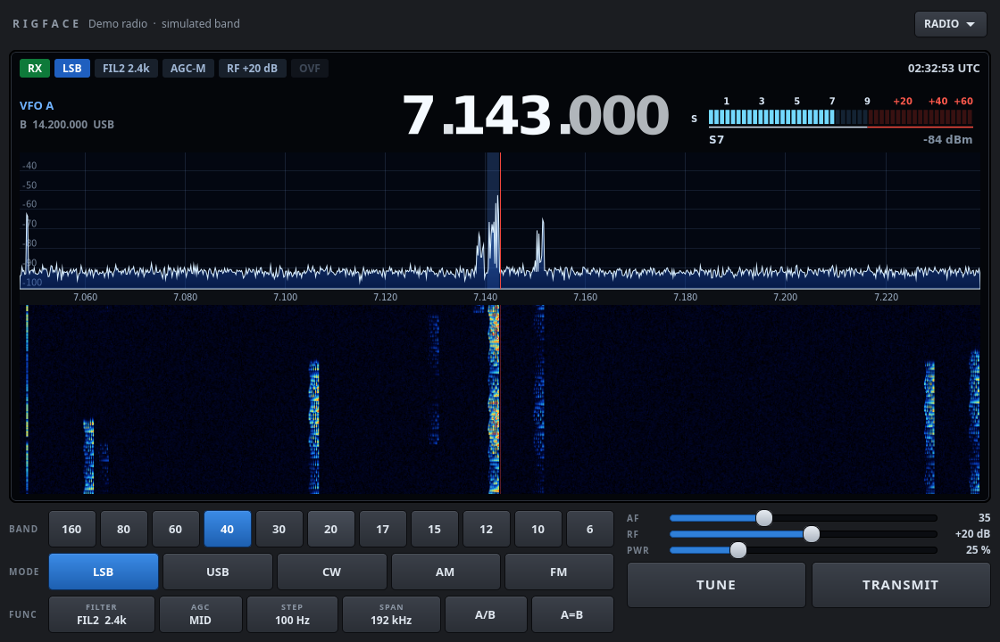

# Rigface

A GTK4 transceiver-style front panel for SDR transceivers: big frequency
readout, S-meter, spectrum scope with waterfall, band/mode/filter keys.

*`rigface --demo`: the simulated HF band, tuned to an SSB station on 40 m.*

Two kinds of radio are supported:

- **Radioberry, Hermes-Lite and other HPSDR Protocol 1 radios**, over UDP
  (port 1024). For a Radioberry that is the standard `radioberry` daemon, so
  this runs either on the Pi itself or on another machine on the same network.
- **QRP Labs QMX / QMX+**, over its USB cable (CAT serial port plus its sound
  card in IQ mode). See [QMX](#qrp-labs-qmx) below.

Demodulation and audio are done here, in Python with numpy.

## Run

    ./bin/rigface                    # discover a radio on the network or USB
    ./bin/rigface --radio 192.168.1.50
    ./bin/rigface --radio qmx        # QMX on USB (or qmx:/dev/ttyACM0)
    ./bin/rigface --demo             # no hardware: simulated HF band
    ./bin/rigface --demo qmx         # the same band through a simulated QMX

Needs Python 3, PyGObject with GTK 4 and GStreamer, numpy and scipy. On
Raspberry Pi OS / Debian / Ubuntu:

    sudo apt install python3-gi gir1.2-gtk-4.0 gir1.2-gstreamer-1.0 \
        gstreamer1.0-plugins-base gstreamer1.0-plugins-good \
        gstreamer1.0-pulseaudio python3-numpy python3-scipy

## Operating

| Action | How |
| --- | --- |
| Tune | scroll wheel or arrow keys (Up/Down = 10 steps); drag the scope |
| Tune one digit | scroll over that digit, or click its top/bottom half |
| Jump to a signal | click it on the scope or waterfall |
| Enter a frequency | type it and press Enter (`7.1` or `14074` = MHz / kHz) |
| Band | band keys; each band remembers its last frequency and mode |
| Filter / AGC / step / span | FUNC keys cycle through the choices |
| Transmit | TRANSMIT toggles; Esc always returns to receive |
| Carrier | TUNE, or TRANSMIT in CW mode |

Transmit drops automatically after three minutes or if the radio stops
responding. Settings are saved to `~/.config/rigface/config.json` on
exit; that file also holds a few things with no on-screen control:
`iq_swap` (set true if the sidebands come out reversed), `mic_gain`,
`audio_sink` and `audio_source` (GStreamer element descriptions).

## QRP Labs QMX

Plug the QMX in with its USB cable; nothing needs setting on the radio. The
panel switches it to IQ mode for the session (CAT `Q91;`, undone on exit and
never saved by the radio), reads the raw I/Q from the QMX sound card and
demodulates it here. What is different from an HPSDR radio:

- The scope is 48 kHz wide and the tuned frequency sits right of centre: the
  QMX has a 12 kHz IF, so its I/Q is centred 12 kHz (CW: 12.7 kHz) below the
  dial. The exact figure is read from the radio (`PL;`, firmware 1_03_000 on).
- Tuning or changing mode with the radio's own knobs is followed here. The
  panel drives VFO A in simplex; its A/B keys are its own two VFOs.
- Transmit is done by the radio. TRANSMIT in LSB/USB/AM sends `TX;` and plays
  this computer's microphone into the QMX sound card (the SSB source is set to
  USB with `SS0;`; set `qmx_usb_tx_audio` false to use the radio's own mic
  setting). TUNE, and TRANSMIT in CW, key a carrier (`KD1;`); TUNE from a
  voice mode borrows CW mode while it is held.
- The meter shows the measured power and SWR while transmitting. The PWR and
  RF sliders, SPAN and FM do not apply and are greyed out.
- Needs firmware with the CAT commands above (written against the 1_04_003
  CAT manual). The user must be allowed to open the serial port
  (`sudo usermod -aG dialout $USER`, then log in again).

These are set in **RADIO → QMX settings…**: the serial port (automatic by
default), whether to transmit this computer's microphone, microphone gain,
I/Q swap, S-meter calibration and the audio routing. Changes are saved at
once; changing the port or audio routing reconnects the radio.

The same things as config keys: `qmx_port` (empty = find the radio on USB),
`qmx_iq_swap` (true if the scope is mirrored), `qmx_smeter_cal`
(dBm at ADC full scale; the default is a guess), `qmx_audio_in` /
`qmx_audio_out` (GStreamer elements replacing direct ALSA access to the QMX
card, e.g. a `pulsesrc device=...` if the desktop sound server holds it).

If the desktop picks the QMX as its default sound device, receive audio would
be played into the radio; choose your speakers and microphone in the system
sound settings, or set `audio_sink` / `audio_source`.

This backend has only been run against the simulator in `rigface/sim.py`, which
was written from the QMX manuals — not yet against a real QMX.

## C++ version

The same panel also exists in C++ (`src/`), with no Python needed at run time:

    sudo apt install g++ make pkg-config libgtk-4-dev libgstreamer1.0-dev
    make                 # build/rigface and build/rigface-sim
    ./build/rigface --demo
    make check           # smoke test against the simulator (needs a display)

It takes the same options and reads the same settings file as the Python one.

## Layout

    bin/rigface           launcher for a source checkout (or `python3 -m rigface`)
    rigface/protocol.py   HPSDR Protocol 1 client (discovery, streaming, control)
    rigface/qmx.py        QRP Labs QMX client (CAT over serial, I/Q over USB audio)
    rigface/dsp.py        receiver (decimate, filter, demod, AGC) and transmitter
    rigface/audio.py      speaker and microphone via GStreamer
    rigface/widgets.py    frequency readout, meter, scope (Cairo)
    rigface/app.py        the window and operating logic
    rigface/sim.py        simulated radios; also `python3 -m rigface.sim [--qmx]` standalone
    tests/                `test_headless.py` (DSP + both radios), `smoke_gui.py [qmx]`

`protocol.Radio` and `qmx.Radio` share one interface (described at the top of
`protocol.Radio`), including what the radio can do — sample rates, modes,
frequency range, whether gain and power are adjustable — and the panel adapts
to it. A third radio is another such class plus a line in `Panel.connect`.

## Not there yet

CW keying (paddle/straight key), split, noise reduction/blanker, and a real
power/SWR readout on HPSDR radios — there the meter shows the drive setting
while transmitting. The S-meter calibration is a nominal constant per radio
type (`smeter_cal`). On the QMX: its DIGI mode, RIT, and showing transmit
keyed at the radio itself (paddle or its own PTT).
